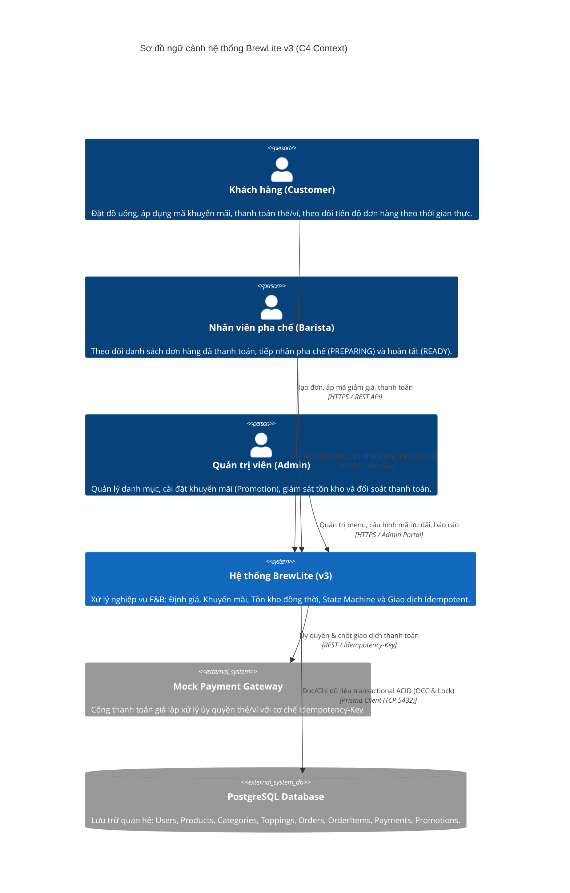
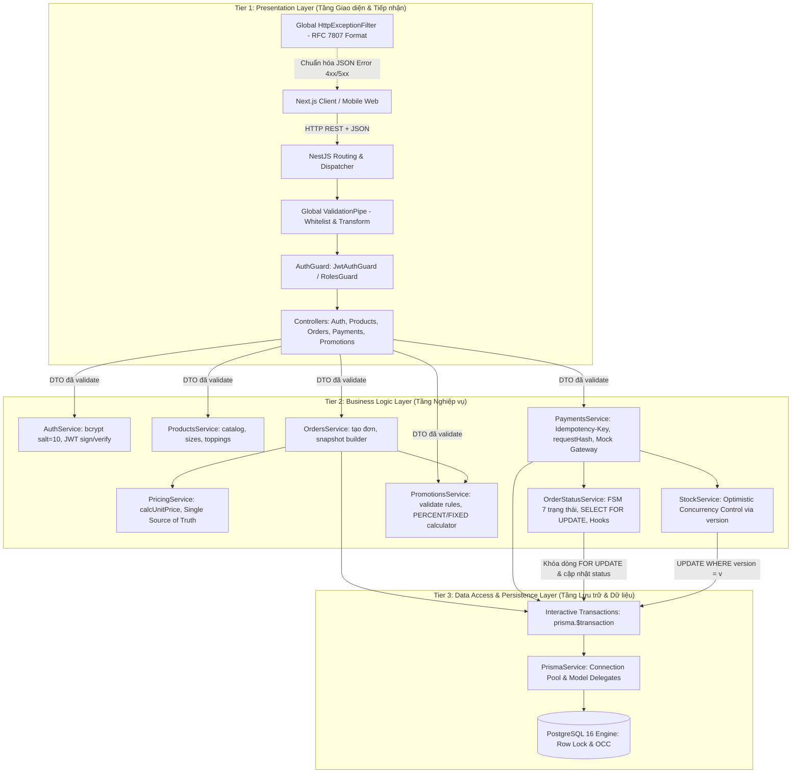
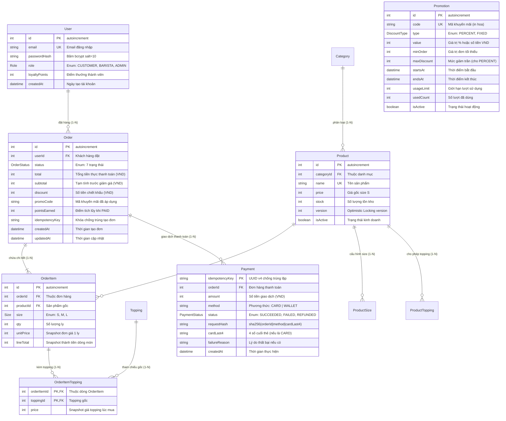
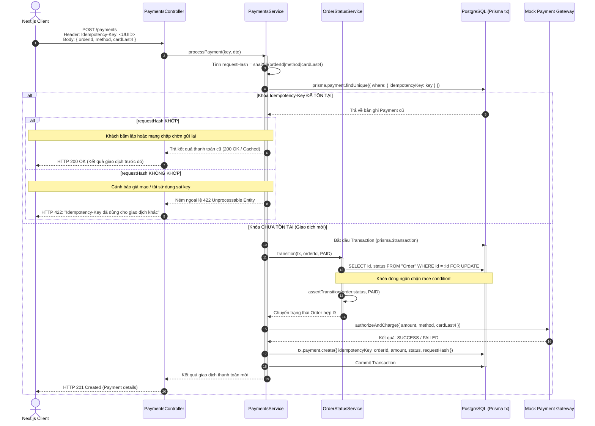
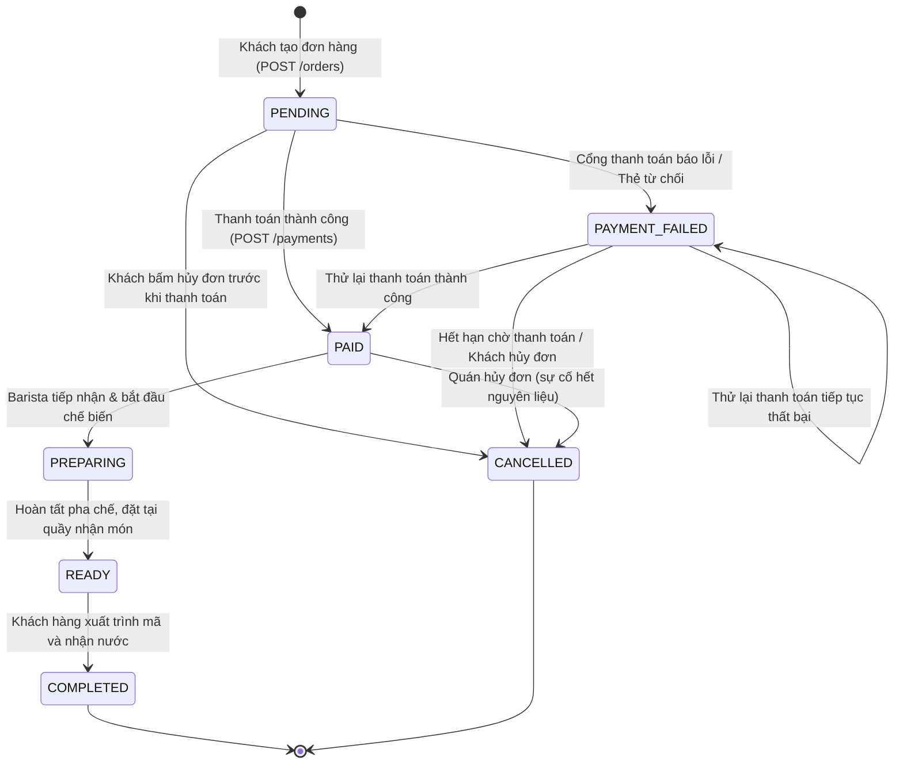

# Tài liệu Thiết kế Kiến trúc Hệ thống – BrewLite (v3.0)

> **Mã công việc:** Sub-task 31.1 (Sprint 3 Architecture Update & Delivery)  
> **Người thực hiện:** M2 (Software Architect / Tech Lead)  
> **Dự án:** BrewLite – Hệ thống đặt cà phê không tiền mặt (Cashless Coffee Ordering System)  
> **Phiên bản:** 3.0.0 (Sprint 3: Advanced Business Logic, Idempotency & Concurrency)  
> **Hệ quản trị CSDL mục tiêu:** PostgreSQL 16+ (Docker Dev / Neon Serverless)  
> **Công nghệ nền tảng:** NestJS 10+ (Backend), Next.js 14+ App Router (Frontend), Prisma ORM 5.19+

---

## 1. Tổng quan hệ thống (System Overview & Context v3)

### 1.1. Bối cảnh nghiệp vụ Sprint 3

Sprint 3 đưa BrewLite từ hệ thống đặt hàng cơ bản lên một nền tảng thương mại F&B hoàn chỉnh, an toàn cao và chịu tải đồng thời:

- **Thanh toán không tiền mặt (Cashless Payments):** Tích hợp Mock Payment Gateway, hỗ trợ thẻ ngân hàng (Card) và ví điện tử (Wallet).
- **Cơ chế Idempotency chống trừ tiền trùng lặp:** Bắt buộc Header `Idempotency-Key` (UUID v4) kết hợp mã băm kiểm tra toàn vẹn payload (`requestHash`), khóa dòng bi quan `SELECT ... FOR UPDATE` khi giao dịch.
- **Cỗ máy trạng thái đơn hàng tập trung (Centralized Order State Machine):** `OrderStatusService` là chốt chặn duy nhất thay đổi trạng thái đơn, kiểm soát nghiêm ngặt 7 trạng thái với ma trận chuyển đổi và kích hoạt các Hook nghiệp vụ tự động (tích điểm khi `PAID`, hoàn kho và hủy điểm khi `CANCELLED`).
- **Khuyến mãi thông minh (Promotions Engine):** Quản lý mã giảm giá theo tỷ lệ phần trăm (`PERCENT`) hoặc số tiền cố định (`FIXED`), kiểm tra điều kiện đơn tối thiểu (`minOrder`), mức giảm trần (`maxDiscount`), thời hạn và giới hạn lượt dùng (`usageLimit`).
- **Kiểm soát tồn kho đồng thời (Optimistic Concurrency Control - OCC):** Sử dụng trường `version` trên bảng `Product` để trừ tồn kho an toàn mà không làm nghẽn kết nối cơ sở dữ liệu.

### 1.2. Sơ đồ ngữ cảnh hệ thống v3 (C4 Context Diagram)



---

## 2. Kiến trúc phân tầng Modular Monolith (Layered Architecture v3)

Hệ thống Backend BrewLite tiếp tục tuân thủ kiến trúc **3 lớp (Three-Tier Layered Architecture)** chuẩn hóa trong mô hình **Modular Monolith** của NestJS:



---

## 3. Đặc tả 8 Module nghiệp vụ cốt lõi Backend (NestJS Modules v3)

Trong Sprint 3, hệ thống được module hóa thành **8 module chuyên trách**:

### 3.1. `ProductsModule`: Danh mục & Thông tin sản phẩm

- **Nhiệm vụ:** Quản lý danh mục (`Category`), sản phẩm (`Product`), cấu hình kích cỡ (`ProductSize`) và danh sách topping khả dụng (`ProductTopping`).
- **Đặc điểm v3:** Bổ sung trường `version Int` phục vụ kiểm soát tồn kho đồng thời.

### 3.2. `AuthModule`: Xác thực & Phân quyền RBAC

- **Nhiệm vụ:** Đăng ký, đăng nhập JWT stateless (HS256, hạn 1 giờ), băm mật khẩu `bcrypt` (salt = 10 rounds).
- **Đặc điểm v3:** Hỗ trợ 3 vai trò người dùng trong hệ thống: `CUSTOMER`, `BARISTA`, `ADMIN`.

### 3.3. `PricingModule`: Đơn vị tính giá duy nhất (Single Source of Truth)

- **Nhiệm vụ:** Tính toán đơn giá từng ly (`calcUnitPrice`), phụ thu size và tổng giá trị dòng món.
- **Nguyên tắc:** Zero Client Trust – máy chủ tự truy vấn giá gốc từ CSDL và bỏ qua mọi thông số giá client gửi lên.

### 3.4. `OrdersModule`: Khởi tạo & Truy vấn đơn hàng

- **Nhiệm vụ:** Tiếp nhận giỏ hàng, gọi `PricingService` tạo snapshot kế toán bất biến (`OrderItem`, `OrderItemTopping`), lưu đơn ở trạng thái ban đầu `PENDING`.
- **Endpoints:** `POST /orders`, `GET /orders/me`, `GET /orders/:id`.

### 3.5. `OrderStatusModule` (`OrderStatusService`): Cỗ máy trạng thái tập trung (MỚI)

- **Nhiệm vụ:** **Nơi duy nhất được phép cập nhật `Order.status`** trên toàn hệ thống.
- **Cơ chế an toàn:** Khóa dòng bi quan (`SELECT ... FOR UPDATE`) bên trong transaction để loại bỏ race condition khi nhiều sự kiện đồng thời tác động lên một đơn.
- **Ma trận trạng thái:** Kiểm tra cặp chuyển đổi qua `assertTransition(from, to)`. Nếu vi phạm ném `409 Conflict` (`INVALID_TRANSITION`).
- **Hook điều phối:**
  - `onPaid`: Kích hoạt cộng điểm thưởng thành viên (Loyalty).
  - `onCancelled`: Kích hoạt hoàn trả tồn kho và thu hồi điểm thưởng.

### 3.6. `PaymentsModule`: Thanh toán Idempotent & Mock Gateway (MỚI)

- **Nhiệm vụ:** Xử lý thanh toán không tiền mặt cho đơn hàng qua phương thức thẻ (`CARD`) hoặc ví (`WALLET`).
- **Bảo mật Idempotency:** Bắt buộc Header `Idempotency-Key` (UUID v4).
- **Kiểm tra toàn vẹn:** Sinh `requestHash = sha256(orderId|method|cardLast4)`.
  - Khóa trùng + hash trùng $\rightarrow$ Trả kết quả đã cache (200 OK).
  - Khóa trùng + hash lệch $\rightarrow$ Trả `422 Unprocessable Entity` (phát hiện giả mạo).
  - Khóa mới $\rightarrow$ Xử lý thanh toán qua Mock Gateway, gọi `OrderStatusService.transition(..., PAID)`.

### 3.7. `PromotionsModule`: Động cơ khuyến mãi & Giảm giá (MỚI)

- **Nhiệm vụ:** Xác thực và áp dụng mã voucher ưu đãi cho đơn hàng.
- **Hỗ trợ 2 kiểu chiết khấu:**
  - `PERCENT`: Giảm theo tỷ lệ % (ví dụ 10%), có chặn mức giảm tối đa `maxDiscount`.
  - `FIXED`: Giảm số tiền cố định (ví dụ 15.000 VND).
- **Quy tắc kiểm duyệt:** Kiểm tra ngày hiệu lực (`startsAt <= now <= endsAt`), trạng thái kích hoạt (`isActive`), giá trị đơn tối thiểu (`minOrder`), và giới hạn lượt dùng (`usedCount < usageLimit`). Tăng `usedCount` nguyên tử khi đơn thanh toán thành công.

### 3.8. `StockModule`: Quản lý tồn kho bằng Optimistic Concurrency Control (MỚI)

- **Nhiệm vụ:** Kiểm soát số lượng đồ uống khả dụng, ngăn chặn hiện tượng bán âm kho (overselling) trong các khung giờ cao điểm.
- **Cơ chế:** Dùng Optimistic Locking với trường `Product.version`. Thực hiện trừ kho không cần khóa đọc, chỉ khóa điều kiện khi ghi `UPDATE ... WHERE id = ... AND version = ... AND stock >= qty`.

---

## 4. Mô hình Dữ liệu Bổ sung ERD v3 (Database Schema v3)

### 4.1. Sơ đồ thực thể quan hệ ERD v3 (Mermaid)



### 4.2. Danh mục Enum mới trong Sprint 3

```typescript
// Trạng thái giao dịch thanh toán
export enum PaymentStatus {
  SUCCEEDED = 'SUCCEEDED', // Thanh toán thành công
  FAILED = 'FAILED', // Giao dịch bị từ chối / lỗi số dư
  REFUNDED = 'REFUNDED', // Đã hoàn tiền về tài khoản
}

// Kiểu chiết khấu của chương trình khuyến mãi
export enum DiscountType {
  PERCENT = 'PERCENT', // Giảm theo % giá trị đơn
  FIXED = 'FIXED', // Giảm trừ số tiền trực tiếp (VND)
}

// Vòng đời đơn hàng 7 trạng thái chuẩn hóa
export enum OrderStatus {
  PENDING = 'PENDING', // Đơn vừa tạo, chờ thanh toán
  PAID = 'PAID', // Đã thanh toán thành công
  PAYMENT_FAILED = 'PAYMENT_FAILED', // Thanh toán thất bại, chờ thử lại
  PREPARING = 'PREPARING', // Barista đang pha chế
  READY = 'READY', // Sẵn sàng tại quầy, chờ khách lấy
  COMPLETED = 'COMPLETED', // Khách đã nhận món (hoàn tất)
  CANCELLED = 'CANCELLED', // Đơn đã hủy
}
```

---

## 5. Nguyên tắc Thiết kế, Bảo mật & Đồng thời cốt lõi

### 5.1. Cơ chế Idempotency & Bảo mật thanh toán chuyên sâu

Nhằm ngăn chặn hiện tượng trừ tiền hai lần và phát hiện kịp thời các nỗ lực tấn công đổi payload, quy trình thanh toán áp dụng cơ chế 4 bước nghiêm ngặt:



### 5.2. Kiểm soát tồn kho đồng thời với Optimistic Concurrency Control (OCC)

Thay vì dùng `SELECT ... FOR UPDATE` làm nghẽn toàn bộ luồng duyệt menu của khách hàng, bảng `Product` áp dụng Optimistic Locking:

1. Đọc dữ liệu tự do không khóa:
   ```typescript
   const product = await prisma.product.findUnique({ where: { id: productId } });
   ```
2. Thực thi câu lệnh cập nhật có điều kiện kiểm tra phiên bản:
   ```sql
   UPDATE "Product"
   SET "stock" = "stock" - :qty,
       "version" = "version" + 1
   WHERE "id" = :productId
     AND "version" = :currentVersion
     AND "stock" >= :qty;
   ```
3. Nếu số dòng cập nhật thành công (`affectedRows === 1`), việc trừ tồn kho hoàn tất an toàn. Nếu `affectedRows === 0`, hệ thống nhận diện đã có tiến trình khác can thiệp đồng thời hoặc món đã hết hàng, từ đó tiến hành retry tự động với backoff trước khi phản hồi lỗi `409 Conflict`.

---

## 6. Luồng nghiệp vụ cốt lõi & Cỗ máy trạng thái đơn hàng (FSM v3)

### 6.1. Sơ đồ State Machine 7 trạng thái (Mermaid)



### 6.2. Ma trận 49 cặp chuyển đổi trạng thái & Tác vụ Hooks đi kèm

Cỗ máy trạng thái tuân thủ ma trận kiểm tra nghiêm ngặt $7 \times 7 = 49$ cặp trạng thái:

| Trạng thái nguồn (`from`) | Trạng thái đích hợp lệ (`to`)         | Tác nhân kích hoạt           | Tác vụ kích hoạt đi kèm (Lifecycle Hooks)                                                                                           |
| :------------------------ | :------------------------------------ | :--------------------------- | :---------------------------------------------------------------------------------------------------------------------------------- |
| **`PENDING`**             | `PAID`, `PAYMENT_FAILED`, `CANCELLED` | Khách hàng / Cổng thanh toán | • Vào `PAID`: Kích hoạt Hook tích điểm thưởng thành viên (`LoyaltyService`).<br>• Vào `CANCELLED`: Không cần hoàn điểm (chưa tích). |
| **`PAYMENT_FAILED`**      | `PAID`, `PAYMENT_FAILED`, `CANCELLED` | Khách hàng / Cổng thanh toán | • Vào `PAID`: Kích hoạt Hook tích điểm thưởng thành viên.<br>• `PAYMENT_FAILED`: Ghi nhận lý do thất bại.                           |
| **`PAID`**                | `PREPARING`, `CANCELLED`              | Barista / Quản lý cửa hàng   | • Vào `CANCELLED`: Kích hoạt Hook hoàn trả tồn kho (`StockService`) và thu hồi điểm loyalty đã tích.                                |
| **`PREPARING`**           | `READY`                               | Barista quầy pha chế         | Đổi cờ trạng thái, gửi thông báo đồ uống sẵn sàng.                                                                                  |
| **`READY`**               | `COMPLETED`                           | Khách hàng / Nhân viên quầy  | Đóng đơn hàng, hoàn tất chu trình phục vụ.                                                                                          |
| **`COMPLETED`**           | _(Không có - Trạng thái kết thúc)_    | —                            | Cấm mọi hành vi chuyển trạng thái tiếp theo (Ném `409 INVALID_TRANSITION`).                                                         |
| **`CANCELLED`**           | _(Không có - Trạng thái kết thúc)_    | —                            | Cấm mọi hành vi phục hồi hoặc đổi sang trạng thái khác.                                                                             |

> [!IMPORTANT]
> Toàn bộ 42 cặp trạng thái còn lại (như `PENDING` $\rightarrow$ `READY`, `COMPLETED` $\rightarrow$ `PREPARING`, `READY` $\rightarrow$ `PREPARING`, `CANCELLED` $\rightarrow$ `PAID`...) đều bị cấm tuyệt đối và được bảo vệ bởi bộ Unit Test ma trận 49 cặp (`order-state-machine.spec.ts`).

---

## 7. Danh mục Quyết định Kiến trúc (ADR Index)

| Mã ADR      | Tiêu đề quyết định                                                                                                                                                              | Trạng thái   | Ngày duyệt     | Phạm vi                     |
| :---------- | :------------------------------------------------------------------------------------------------------------------------------------------------------------------------------ | :----------- | :------------- | :-------------------------- |
| **ADR-001** | Lựa chọn kiến trúc Modular Monolith trên nền tảng NestJS & Next.js App Router                                                                                                   | Accepted     | 2026-10-15     | Toàn hệ thống               |
| **ADR-002** | Lựa chọn PostgreSQL và Prisma ORM làm nền tảng CSDL quan hệ chính thức                                                                                                          | Accepted     | 2026-10-16     | Database & Persistence      |
| **ADR-003** | [Quản lý trạng thái đơn hàng tập trung, Chống thanh toán lặp bằng Idempotency Key và Khóa lạc quan tồn kho](file:///docs/architecture/adr/003-state-machine-and-idempotency.md) | **Accepted** | **2026-10-31** | **Backend Core (Sprint 3)** |
| **ADR-006** | Server-side Pricing as Single Source of Truth & Snapshot Pattern kế toán                                                                                                        | Accepted     | 2026-10-24     | Định giá & Đơn hàng         |
| **ADR-007** | Xác thực phi trạng thái (Stateless Authentication) bằng JWT, Passport & Bcrypt                                                                                                  | Accepted     | 2026-10-24     | Bảo mật & Xác thực          |

---

## 8. Tiêu chí hoàn thành (Definition of Done - DoD v3.0)

- [x] Kiến trúc phân hệ Backend Sprint 3 (`Payments`, `Promotions`, `Stock`, `OrderStatus`) được mô tả chi tiết, rõ ràng ranh giới.
- [x] Sơ đồ tuần tự Sequence Diagram xử lý Idempotency Key, Request Hash và khóa dòng `SELECT ... FOR UPDATE` được tích hợp.
- [x] Sơ đồ State Machine 7 trạng thái và bảng ma trận chuyển đổi kèm các Hook kích hoạt nghiệp vụ (`PAID` tích điểm, `CANCELLED` hoàn kho) được chuẩn hóa.
- [x] Cơ chế Optimistic Concurrency Control (`Product.version`) được mô hình hóa và phân tích rủi ro/đánh đổi rõ ràng.
- [x] Bản ghi quyết định kiến trúc ADR-003 (`docs/architecture/adr/003-state-machine-and-idempotency.md`) được tạo lập chuẩn định dạng.
- [x] Tài liệu markdown chuẩn, cú pháp Mermaid hợp lệ 100%, sẵn sàng cho nghiệm thu Sub-task 31.1.
