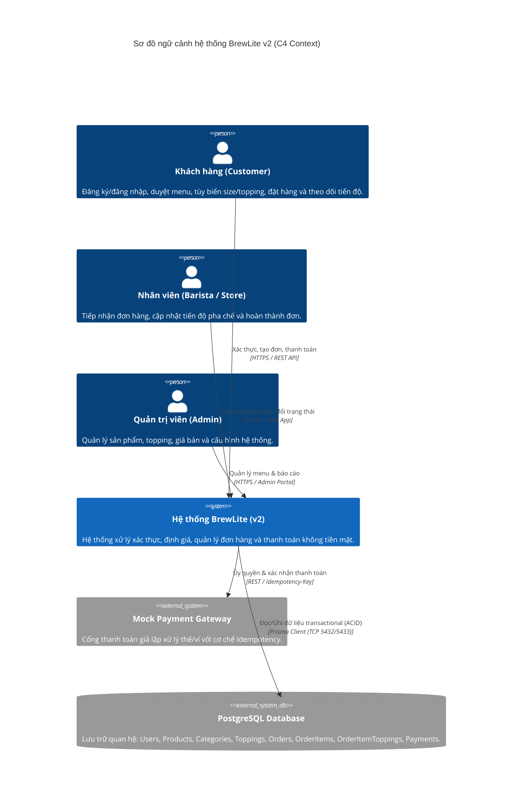
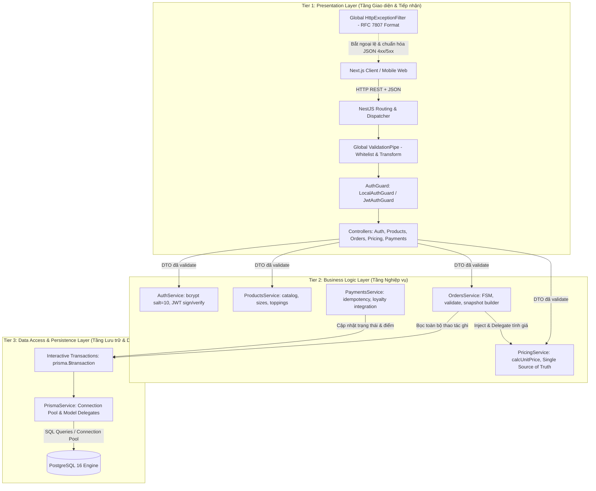
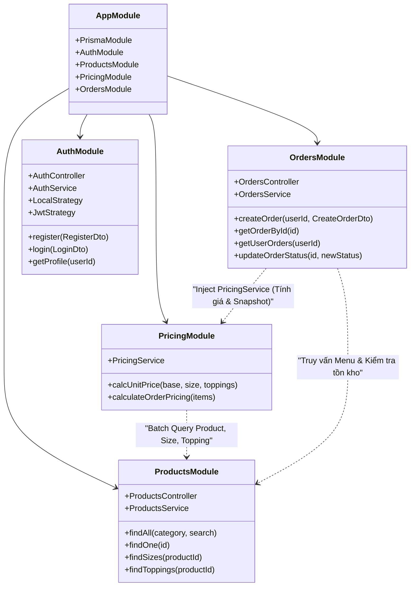
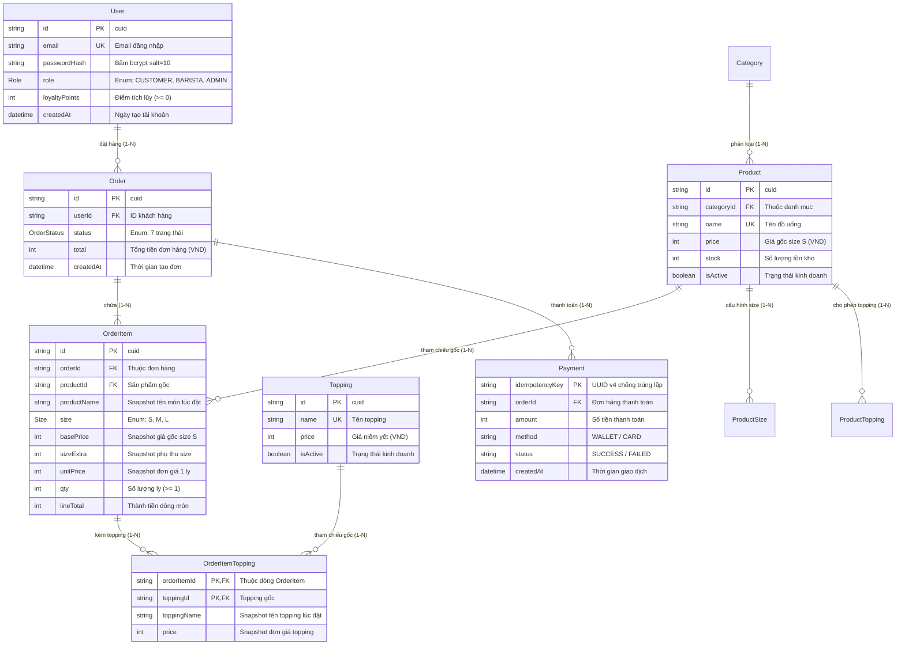
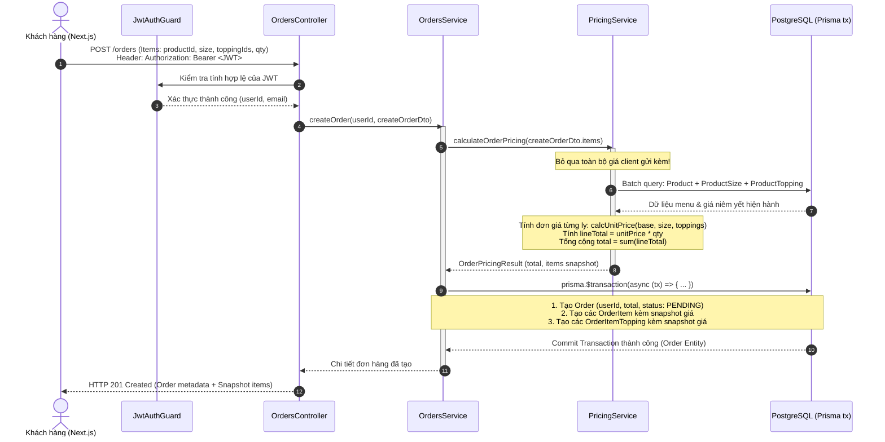
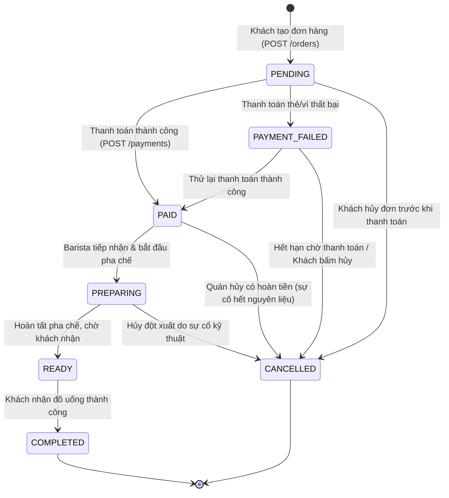

# Tài liệu Thiết kế Kiến trúc Hệ thống – BrewLite (v2.0)

> **Mã công việc:** Sub-task A.1 (Sprint 2 Architecture Update)  
> **Người thực hiện:** M2 (Software Architect / Tech Lead)  
> **Dự án:** BrewLite – Hệ thống đặt cà phê không tiền mặt (Cashless Coffee Ordering System)  
> **Phiên bản:** 2.0.0 (Sprint 2 Architecture & ERD v2)  
> **Hệ quản trị CSDL mục tiêu:** PostgreSQL 16+ (Docker Dev / Neon Serverless)  
> **Công nghệ nền tảng:** NestJS (Backend), Next.js App Router (Frontend), Prisma ORM

---

## 1. Tổng quan hệ thống (System Overview & Context v2)

### 1.1. Bối cảnh nghiệp vụ Sprint 2

BrewLite trong Sprint 2 mở rộng từ hiển thị danh mục sang chu trình đặt hàng khép kín:

- **Xác thực người dùng (Authentication):** Đăng ký, đăng nhập tài khoản khách hàng bằng JWT và bảo mật mật khẩu với bcrypt.
- **Tính giá chuẩn xác (Server-side Pricing):** Đóng vai trò là nguồn sự thật duy nhất (Single Source of Truth), tính toán đơn giá theo size, phụ thu và topping.
- **Quản lý đơn hàng (Order Management):** Tiếp nhận giỏ hàng, xác thực dữ liệu và tạo đơn hàng an toàn thông qua Database Transaction với mô hình Snapshot kế toán.
- **Thanh toán & Tích điểm:** Chuẩn bị luồng thanh toán giả lập với Idempotency Key và tích điểm thành viên (10%).

### 1.2. Sơ đồ ngữ cảnh hệ thống v2 (C4 Context Diagram)



---

## 2. Kiến trúc phân tầng Modular Monolith (Layered Architecture v2)

Hệ thống Backend BrewLite áp dụng kiến trúc **3 lớp (Three-Tier Layered Architecture)** chuẩn hóa trong mô hình **Modular Monolith** của NestJS, phân định ranh giới nghiêm ngặt giữa các tầng:



### 2.1. Phân định trách nhiệm và ranh giới các tầng

| Tầng kiến trúc             | Thành phần đảm nhiệm                                                           | Trách nhiệm chính                                                                                                                                                                                                                                                    | Ranh giới nghiêm ngặt (Boundaries)                                                                                                          |
| :------------------------- | :----------------------------------------------------------------------------- | :------------------------------------------------------------------------------------------------------------------------------------------------------------------------------------------------------------------------------------------------------------------- | :------------------------------------------------------------------------------------------------------------------------------------------ |
| **Tier 1: Presentation**   | Controllers, DTOs, Pipes, Guards, Filters                                      | - Tiếp nhận request HTTP, parse JSON.<br>- Validate định dạng dữ liệu đầu vào qua `ValidationPipe` (`class-validator`).<br>- Xác thực người dùng qua `LocalAuthGuard` và bảo vệ endpoint bằng `JwtAuthGuard`.<br>- Chuẩn hóa phản hồi lỗi qua `HttpExceptionFilter`. | **TUYỆT ĐỐI KHÔNG** query database trực tiếp (không inject `PrismaService`).<br>**TUYỆT ĐỐI KHÔNG** chứa logic tính tiền hoặc băm mật khẩu. |
| **Tier 2: Business Logic** | Services (`AuthService`, `PricingService`, `OrdersService`, `ProductsService`) | - Thực thi toàn bộ nghiệp vụ lõi: băm mật khẩu, so khớp credential, tính giá snapshot, kiểm tra ràng buộc size/topping.<br>- Điều phối máy trạng thái đơn hàng (FSM).<br>- Đảm bảo tính toán giá độc lập với dữ liệu client gửi.                                     | Không phụ thuộc trực tiếp vào HTTP Request/Response objects.<br>Chỉ làm việc với Plain DTOs/Entities đã qua validate.                       |
| **Tier 3: Data Access**    | `PrismaService`, Prisma Client Model Delegates                                 | - Trừu tượng hóa truy vấn SQL, quản lý kết nối connection pool.<br>- Thực thi atomic transaction (`prisma.$transaction`) để bảo vệ tính nhất quán ACID.<br>- Chuyển đổi dữ liệu bảng thành TypeScript Type an toàn 100%.                                             | Không chứa logic nghiệp vụ giá hay xác thực.<br>Tập trung vào truy xuất, lọc, cập nhật và khóa dữ liệu.                                     |

---

## 3. Đặc tả 4 Module nghiệp vụ cốt lõi Backend (NestJS Modules v2)

Trong Sprint 2, Backend được cấu trúc thành **4 module chính** theo mô hình Modular Monolith:



### 3.1. `ProductsModule`: Quản lý danh mục, sản phẩm, size & topping

- **Mục tiêu:** Cung cấp thông tin danh mục, sản phẩm menu, phân loại size và danh sách topping khả dụng kèm giá niêm yết.
- **Thành phần:**
  - `ProductsController`: Tiếp nhận các truy vấn lọc theo category, tìm kiếm theo tên, lấy chi tiết sản phẩm.
  - `ProductsService`: Truy vấn danh sách món hoạt động (`isActive: true`), kèm các quan hệ `sizes` (`ProductSize`) và `toppings` (`ProductTopping -> Topping`).
- **Ranh giới:** Cung cấp dữ liệu danh mục tĩnh/bán tĩnh, không xử lý giỏ hàng hay đơn hàng.

### 3.2. `AuthModule`: Xác thực & Ủy quyền người dùng

- **Mục tiêu:** Quản lý vòng đời tài khoản người dùng, xác thực định danh và cấp phát token an toàn.
- **Thành phần:**
  - `PassportModule`, `JwtModule` (HS256, thời hạn 1 giờ / 3600 giây).
  - `LocalStrategy`: Xác thực tài khoản qua email và mật khẩu thô (sử dụng `bcrypt.compare`).
  - `JwtStrategy`: Giải mã và xác thực token Bearer từ header `Authorization: Bearer <token>`, trích xuất `sub` (userId) và `email` gắn vào `req.user`.
  - `AuthService`:
    - **Băm mật khẩu:** Sử dụng `bcrypt` với `saltRounds = 10` (chuẩn khuyến nghị OWASP).
    - **Fast Pre-check:** Kiểm tra sự tồn tại của email trước khi băm bcrypt để tiết kiệm chu kỳ CPU khi trùng lặp.
    - **Race-condition Handling:** Bắt mã lỗi `P2002` từ Prisma khi có 2 request đăng ký cùng email đến nano-giây cuối.
    - **Timing Attack Prevention (Dummy Compare):** Khi không tìm thấy email, chạy hàm băm giả định để thời gian xử lý đồng nhất, chống lộ thông tin người dùng (User Enumeration).
    - **Bảo vệ RAM:** Dùng Prisma `select` loại bỏ triệt để trường `passwordHash`, không bao giờ nạp vào bộ nhớ hoặc trả về API.

### 3.3. `PricingModule` (`PricingService`): Single Source of Truth về giá

- **Mục tiêu:** Đóng vai trò là nguồn sự thật duy nhất (Single Source of Truth) về giá bán trên toàn hệ thống, phục vụ cả việc báo giá trước và chốt giá lưu đơn.
- **Thành phần:**
  - `calcUnitPrice(base, size, toppings)`: Hàm thuần túy (pure function) đồng bộ logic 100% với hàm tính giá ở Frontend (`frontend/src/lib/pricing.ts`).
  - `PricingService.calculateOrderPricing(items)`:
    - Tiếp nhận mảng món đặt mua (`OrderItemPricingInput`: `productId`, `size`, `toppingIds`, `qty`).
    - **Bảo mật giá:** Bỏ qua hoàn toàn mọi trường giá client gửi kèm (`clientPrice`, `clientUnitPrice`, `clientLineTotal`) để ngăn chặn tấn công giả mạo giá tiền.
    - **Chống N+1 Query:** Batch query toàn bộ `Product`, `ProductSize`, `ProductTopping` trong một câu truy vấn `findMany({ where: { id: { in: productIds } } })` và map vào bộ nhớ $O(1)$.
    - **Kiểm tra tính hợp lệ:** Xác minh size thuộc sản phẩm (`S`, `M`, `L`), topping thuộc danh sách được phép và đang hoạt động (`isActive = true`), chống chọn trùng lặp topping trong 1 ly.
    - **Tạo Snapshot:** Xuất cấu trúc `OrderItemPricingSnapshot` đầy đủ giá gốc, phụ thu size, giá topping, đơn giá ly và thành tiền từng món.

### 3.4. `OrdersModule`: Tiếp nhận giỏ hàng & Lưu trữ Transactional

- **Mục tiêu:** Quản lý vòng đời đơn hàng, đảm bảo tính toàn vẹn dữ liệu từ lúc tạo giỏ đến khi hoàn tất đơn.
- **Thành phần:**
  - `OrdersController`: Endpoint `POST /orders` (tạo đơn mới), `GET /orders` (lịch sử đơn của user), `GET /orders/:id` (chi tiết đơn), `PATCH /orders/:id/status` (đổi trạng thái đơn cho Barista/Admin).
  - `OrdersService`:
    - Validate DTO đầu vào bằng `class-validator` (chặn số lượng âm, sai định dạng UUID/CUID, sai enum size).
    - Gọi `PricingService.calculateOrderPricing` để tính toán lại tổng tiền và snapshot giá độc lập.
    - **Bọc Database Transaction:** Sử dụng `prisma.$transaction(async (tx) => { ... })` để thực hiện nguyên tử:
      1. Tạo bản ghi `Order` với trạng thái ban đầu `PENDING`.
      2. Tạo danh sách các dòng món `OrderItem` kèm snapshot giá.
      3. Tạo các bản ghi phụ thuộc `OrderItemTopping` cho từng topping của từng ly.
    - Đảm bảo không xảy ra tình trạng đơn hàng tạo thành công nhưng thiếu món hoặc thiếu topping do sự cố ngắt quãng kết nối.

---

## 4. Mô hình Dữ liệu Bổ sung ERD v2 (Database Schema v2)

### 4.1. Sơ đồ thực thể quan hệ ERD v2 (Mermaid)



### 4.2. Định nghĩa các Enum cốt lõi

Hệ thống quy chuẩn 3 Enum trung tâm quản lý quyền hạn, kích cỡ và vòng đời đơn hàng:

```typescript
// 1. Phân quyền người dùng trong hệ thống
export enum Role {
  CUSTOMER = 'CUSTOMER', // Khách hàng đặt món, xem lịch sử và tích điểm
  BARISTA = 'BARISTA', // Nhân viên quầy bar tiếp nhận đơn và cập nhật trạng thái pha chế
  ADMIN = 'ADMIN', // Quản trị viên hệ thống quản lý menu và cấu hình
}

// 2. Kích cỡ đồ uống chuẩn hóa
export enum Size {
  S = 'S', // Size nhỏ (Small) - Giá gốc niêm yết của sản phẩm
  M = 'M', // Size vừa (Medium) - Phụ thu sizeExtra
  L = 'L', // Size lớn (Large) - Phụ thu sizeExtra
}

// 3. Vòng đời đơn hàng đầy đủ 7 trạng thái (chuẩn hóa Sprint 2 & chuẩn bị Sprint 3)
export enum OrderStatus {
  PENDING = 'PENDING', // Đơn vừa tạo, chờ thanh toán
  PAID = 'PAID', // Đã thanh toán thành công
  PAYMENT_FAILED = 'PAYMENT_FAILED', // Thanh toán thất bại, chờ thử lại
  PREPARING = 'PREPARING', // Barista tiếp nhận và đang pha chế
  READY = 'READY', // Đồ uống sẵn sàng tại quầy, chờ khách nhận
  COMPLETED = 'COMPLETED', // Khách đã nhận đồ uống, kết thúc chu trình
  CANCELLED = 'CANCELLED', // Đơn hàng bị hủy (khách hủy hoặc sự cố quán)
}
```

### 4.3. Bảng tra cứu cấu trúc dữ liệu chi tiết (Data Dictionary v2)

#### Bảng `User` (Người dùng)

| Tên cột         | Kiểu dữ liệu   | Ràng buộc                        | Mô tả                                                  |
| :-------------- | :------------- | :------------------------------- | :----------------------------------------------------- |
| `id`            | `VARCHAR(30)`  | `PK`, `@default(cuid())`         | Khóa chính định danh tài khoản                         |
| `email`         | `VARCHAR(255)` | `NOT NULL`, `UNIQUE`             | Email đăng nhập duy nhất                               |
| `passwordHash`  | `VARCHAR(255)` | `NOT NULL`                       | Mật khẩu đã băm bcrypt (salt >= 10)                    |
| `role`          | `ENUM Role`    | `NOT NULL`, `DEFAULT 'CUSTOMER'` | Phân quyền người dùng (`CUSTOMER`, `BARISTA`, `ADMIN`) |
| `loyaltyPoints` | `INTEGER`      | `NOT NULL`, `DEFAULT 0`          | Điểm tích lũy thành viên (>= 0)                        |
| `createdAt`     | `TIMESTAMPTZ`  | `NOT NULL`, `DEFAULT NOW()`      | Thời điểm tạo tài khoản                                |

#### Bảng `Order` (Đơn hàng)

| Tên cột     | Kiểu dữ liệu       | Ràng buộc                        | Mô tả                                   |
| :---------- | :----------------- | :------------------------------- | :-------------------------------------- |
| `id`        | `VARCHAR(30)`      | `PK`, `@default(cuid())`         | Khóa chính định danh đơn hàng           |
| `userId`    | `VARCHAR(30)`      | `NOT NULL`, `FK -> User(id)`     | Khách hàng sở hữu đơn hàng              |
| `status`    | `ENUM OrderStatus` | `NOT NULL`, `DEFAULT 'PENDING'`  | Trạng thái vòng đời (7 trạng thái)      |
| `total`     | `INTEGER`          | `NOT NULL`, `CHECK (total >= 0)` | Tổng giá trị thanh toán cuối cùng (VND) |
| `createdAt` | `TIMESTAMPTZ`      | `NOT NULL`, `DEFAULT NOW()`      | Thời điểm tạo đơn hàng                  |

#### Bảng `OrderItem` (Chi tiết món & Snapshot giá)

| Tên cột       | Kiểu dữ liệu   | Ràng buộc                            | Mô tả                                         |
| :------------ | :------------- | :----------------------------------- | :-------------------------------------------- |
| `id`          | `VARCHAR(30)`  | `PK`, `@default(cuid())`             | Khóa chính chi tiết dòng món                  |
| `orderId`     | `VARCHAR(30)`  | `NOT NULL`, `FK -> Order(id)`        | Thuộc về đơn hàng nào                         |
| `productId`   | `VARCHAR(30)`  | `NOT NULL`, `FK -> Product(id)`      | Tham chiếu sản phẩm gốc                       |
| `productName` | `VARCHAR(150)` | `NOT NULL`                           | **Snapshot** tên món lúc mua                  |
| `size`        | `ENUM Size`    | `NOT NULL`                           | Kích cỡ đã chọn (`S`, `M`, `L`)               |
| `basePrice`   | `INTEGER`      | `NOT NULL`, `CHECK (basePrice >= 0)` | **Snapshot** giá gốc size S tại thời điểm mua |
| `sizeExtra`   | `INTEGER`      | `NOT NULL`, `CHECK (sizeExtra >= 0)` | **Snapshot** phụ thu size tại thời điểm mua   |
| `unitPrice`   | `INTEGER`      | `NOT NULL`, `CHECK (unitPrice >= 0)` | **Snapshot** đơn giá 1 ly hoàn chỉnh          |
| `qty`         | `INTEGER`      | `NOT NULL`, `CHECK (qty >= 1)`       | Số lượng ly đặt mua                           |
| `lineTotal`   | `INTEGER`      | `NOT NULL`, `CHECK (lineTotal >= 0)` | Thành tiền dòng món (`unitPrice * qty`)       |

#### Bảng `OrderItemTopping` (Topping của món & Snapshot giá)

| Tên cột       | Kiểu dữ liệu   | Ràng buộc                        | Mô tả                                          |
| :------------ | :------------- | :------------------------------- | :--------------------------------------------- |
| `orderItemId` | `VARCHAR(30)`  | `PK`, `FK -> OrderItem(id)`      | Thuộc dòng món OrderItem nào                   |
| `toppingId`   | `VARCHAR(30)`  | `PK`, `FK -> Topping(id)`        | Tham chiếu topping gốc                         |
| `toppingName` | `VARCHAR(100)` | `NOT NULL`                       | **Snapshot** tên topping lúc mua               |
| `price`       | `INTEGER`      | `NOT NULL`, `CHECK (price >= 0)` | **Snapshot** đơn giá topping tại thời điểm mua |

### 4.4. Phân tích kiến trúc: Snapshot Pattern & Tính toàn vẹn kế toán

1. **Vấn đề thực tế F&B:**
   - Menu thường xuyên thay đổi giá theo chiến dịch (ví dụ: Trà Đào tăng từ 35.000đ lên 40.000đ).
   - Topping có thể bị gỡ bỏ hoặc tạm dừng bán (`isActive = false`).
   - Nếu đơn hàng chỉ lưu khóa ngoại `productId` và `toppingId`, khi xuất lại hóa đơn lịch sử hoặc chạy báo cáo doanh thu kế toán, hệ thống sẽ tính theo giá hiện tại, làm **sai lệch số liệu tài chính trong quá khứ**.
2. **Giải pháp Snapshot Pattern trong ERD v2:**
   - Toàn bộ tên món, giá gốc, phụ thu size, tên topping, giá topping và đơn giá từng dòng đều được lưu trữ trực tiếp dưới dạng bản ghi bất biến (Immutable Record).
   - Đảm bảo tính toán độc lập, xem lại hóa đơn sau 1 năm vẫn giữ nguyên chính xác từng đồng so với thời điểm khách thanh toán.

---

## 5. Nguyên tắc Thiết kế & Giao tiếp cốt lõi (Core Principles)

### 5.1. Contract-first: Giao tiếp nghiêm ngặt giữa Frontend & Backend

- Mọi tương tác API giữa ứng dụng Next.js và Backend NestJS phải tuân thủ nghiêm ngặt hợp đồng giao tiếp được định nghĩa tại `docs/api-contract.md` v2 (kết hợp các quy chuẩn chung tại `docs/api-conventions.md`).
- **DTO Validation:** Toàn bộ payload đầu vào được validate qua Global `ValidationPipe`:
  ```typescript
  new ValidationPipe({
    whitelist: true, // Tự động loại bỏ field không khai báo
    forbidNonWhitelisted: true, // Báo lỗi 400 nếu truyền field lạ
    transform: true, // Chuyển đổi kiểu tự động
  });
  ```
- **Chuẩn hóa Error Response:** Mọi lỗi 4xx/5xx được chuẩn hóa theo định dạng RFC 7807 mở rộng:
  ```json
  {
    "statusCode": 400,
    "message": ["size must be one of the following values: S, M, L"],
    "error": "Bad Request",
    "path": "/orders",
    "timestamp": "2026-10-20T04:20:00.000Z"
  }
  ```

### 5.2. Idempotency & Transactional Integrity: Tính toàn vẹn giao dịch

- **Database Transaction (`prisma.$transaction`):** Thao tác tạo đơn hàng liên quan đến 3 thực thể (`Order`, `OrderItem`, `OrderItemTopping`). Để tránh phân mảnh dữ liệu (Data Fragmentation) hoặc sinh ra bản ghi mồ côi khi mạng chập chờn, toàn bộ chu trình ghi phải nằm trong một Interactive Transaction duy nhất:
  ```typescript
  // Minh họa Transaction tạo đơn hàng nguyên tử
  return await this.prisma.$transaction(async (tx) => {
    // 1. Tạo đơn hàng với trạng thái ban đầu PENDING
    const order = await tx.order.create({
      data: {
        userId,
        status: OrderStatus.PENDING,
        total: pricingResult.total,
      },
    });

    // 2. Tạo toàn bộ OrderItem & OrderItemTopping với snapshot giá
    for (const item of pricingResult.items) {
      await tx.orderItem.create({
        data: {
          orderId: order.id,
          productId: item.productId,
          productName: item.productName,
          size: item.size,
          basePrice: item.basePrice,
          sizeExtra: item.sizeExtra,
          unitPrice: item.unitPrice,
          qty: item.qty,
          lineTotal: item.lineTotal,
          toppings: {
            create: item.toppings.map((t) => ({
              toppingId: t.toppingId,
              toppingName: t.toppingName,
              price: t.price,
            })),
          },
        },
      });
    }

    return order;
  });
  ```
- **Idempotency với `Idempotency-Key`:** Endpoint thanh toán `POST /payments` bắt buộc truyền UUID v4 duy nhất trong Header `Idempotency-Key`. Nếu một giao dịch với key đó đã tồn tại, hệ thống trả về kết quả đã xử lý trước đó mà không thực hiện trừ tiền hay thay đổi trạng thái đơn lần hai.

### 5.3. Server-side Price Calculation: Chống gian lận giá

- **Nguyên tắc "Zero Client Trust":** Tuyệt đối không tin tưởng bất kỳ thông tin giá nào do Frontend hoặc client gửi lên (kể cả `price`, `unitPrice`, `total`).
- `OrdersService` chỉ nhận danh sách định danh: `productId`, `size`, `toppingIds`, `qty`.
- `PricingService` truy vấn trực tiếp giá gốc của món từ bảng `Product`, phụ thu size từ `ProductSize`, và giá topping từ bảng `Topping` đang hoạt động trong CSDL.
- Tính toán lại toàn bộ `lineTotal`, `subtotal` và `total` trên Server. Mọi trường giá giả mạo gửi kèm trong request body đều bị loại bỏ hoặc bỏ qua hoàn toàn.

---

## 6. Luồng nghiệp vụ cốt lõi & Máy trạng thái đơn hàng (FSM v2)

### 6.1. Sequence Diagram: Luồng Tạo Đơn Hàng & Tính Giá Server-side



### 6.2. Máy trạng thái đơn hàng (Order State Machine - Đủ 7 trạng thái)

Đơn hàng tuân thủ quy trình chuyển đổi trạng thái nghiêm ngặt theo máy trạng thái hữu hạn (Finite State Machine):



#### Ma trận chuyển đổi trạng thái hợp lệ (State Transition Matrix):

| Trạng thái hiện tại  | Trạng thái tiếp theo cho phép         | Tác nhân kích hoạt               | Ghi chú nghiệp vụ                                              |
| :------------------- | :------------------------------------ | :------------------------------- | :------------------------------------------------------------- |
| **`PENDING`**        | `PAID`, `PAYMENT_FAILED`, `CANCELLED` | Hệ thống thanh toán / Khách hàng | Đơn vừa tạo, chờ xác nhận giao dịch thanh toán.                |
| **`PAYMENT_FAILED`** | `PAID`, `CANCELLED`                   | Cổng thanh toán / Khách hàng     | Cho phép thử lại thanh toán với phương thức khác hoặc hủy đơn. |
| **`PAID`**           | `PREPARING`, `CANCELLED`              | Barista / Quản lý cửa hàng       | Đơn đã thanh toán, chuyển vào hàng đợi pha chế.                |
| **`PREPARING`**      | `READY`, `CANCELLED`                  | Barista quầy pha chế             | Đang chế biến đồ uống theo công thức.                          |
| **`READY`**          | `COMPLETED`                           | Khách hàng / Nhân viên quầy      | Đồ uống đã sẵn sàng tại quầy, chờ khách đến lấy.               |
| **`COMPLETED`**      | _(Trạng thái kết thúc)_               | Hệ thống                         | Khách đã lấy nước, tích điểm thành viên hoàn tất.              |
| **`CANCELLED`**      | _(Trạng thái kết thúc)_               | Hệ thống / Khách hàng            | Đơn đã hủy, giải phóng đơn hàng hoặc hoàn tiền (nếu đã paid).  |

---

## 7. Các Quyết định Kiến trúc Bổ sung (Architectural Decision Records - ADR v2)

### ADR-006: Server-side Pricing as Single Source of Truth & Snapshot Pattern

- **Bối cảnh:** Ứng dụng F&B có nguy cơ bị can thiệp payload HTTP gửi giá giả mạo (ví dụ: sửa 50.000đ thành 1.000đ). Đồng thời, menu thường xuyên thay đổi giá gây sai lệch số liệu kế toán lịch sử đơn hàng.
- **Quyết định:**
  1. Triển khai `PricingService` tập trung phía Server đóng vai trò Single Source of Truth. Bỏ qua mọi thông tin giá do client gửi lên.
  2. Áp dụng Snapshot Pattern: Bảng `OrderItem` và `OrderItemTopping` lưu snapshot bất biến toàn bộ tên món, giá gốc, phụ thu size và giá topping tại thời điểm tạo đơn.
- **Hệ quả:** Tăng thêm vài cột lưu trữ trong DB nhưng đảm bảo an toàn tuyệt đối về mặt tài chính và dữ liệu lịch sử kế toán.

### ADR-007: Xác thực phi trạng thái (Stateless Authentication) bằng JWT & Passport

- **Bối cảnh:** Hệ thống cần xác thực nhanh, phục vụ ứng dụng web Next.js và sẵn sàng cho mobile app mà không tạo áp lực lưu session state trên backend.
- **Quyết định:** Sử dụng **Passport** với **LocalStrategy** (đăng nhập email/password) và **JwtStrategy** (xác thực token Bearer), thuật toán **HS256**, thời hạn sống của token là **1 giờ (3600s)**. Mật khẩu băm bằng **bcrypt** với **10 rounds salt**.
- **Cơ chế an toàn:**
  - Fast pre-check email và Dummy compare chống Timing Attack khi đăng nhập.
  - Loại bỏ hoàn toàn trường `passwordHash` trong mọi truy vấn nghiệp vụ qua Prisma `select`.
- **Hệ quả:** Token stateless không thể thu hồi tức thì trước khi hết hạn (trừ khi có blacklist Redis). Thời hạn 1 giờ là cân bằng lý tưởng cho giai đoạn hiện tại.

---

## 8. Kế hoạch xác thực kiến trúc & Tiêu chí hoàn thành (Definition of Done)

- [x] Mô hình phân tầng Modular Monolith của NestJS với 4 module (`ProductsModule`, `AuthModule`, `PricingModule`, `OrdersModule`) được đặc tả chi tiết.
- [x] Mô hình dữ liệu ERD v2 với đầy đủ quan hệ thực thể, Snapshot Pattern và 3 Enum chuẩn hóa (`Role`, `Size`, `OrderStatus` 7 trạng thái) được tích hợp hoàn chỉnh.
- [x] Ba nguyên tắc cốt lõi (Contract-first, Idempotency & Transactional Integrity, Server-side Pricing) được làm rõ cơ chế thực thi và code minh họa.
- [x] Sơ đồ tuần tự (Sequence Diagram) và Máy trạng thái đơn hàng (FSM 7 trạng thái kèm ma trận chuyển đổi) được chuẩn hóa.
- [x] Toàn bộ tài liệu viết bằng Markdown chuẩn, sơ đồ Mermaid kết xuất không lỗi cú pháp, sẵn sàng làm cơ sở nghiệm thu cho Sprint 2.
