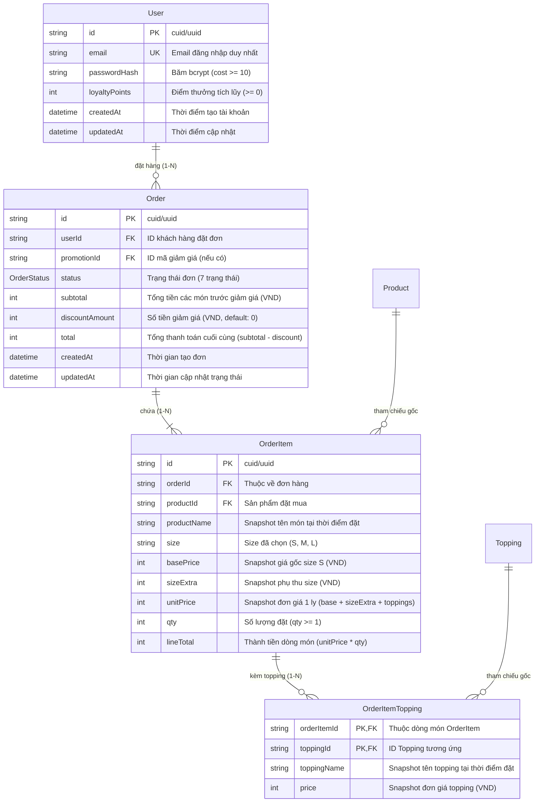
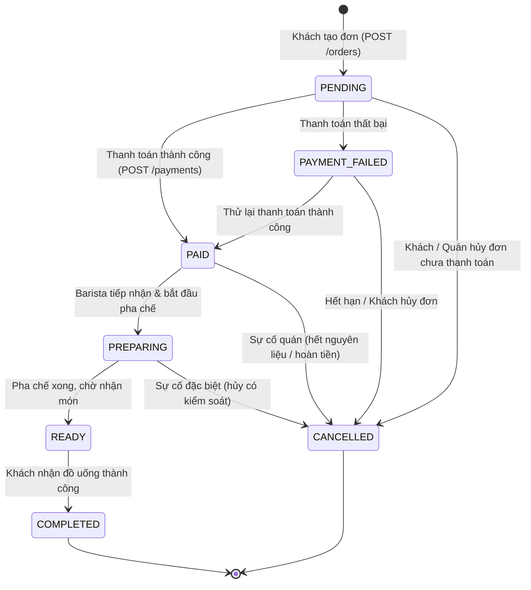

# Thiết kế CSDL & Sơ đồ ERD v2 – Dự án BrewLite

> **Tài liệu bàn giao Sub-task E.1 (PB-07) – Sprint 2**  
> **Người thực hiện:** M2 (Software Architect / Tech Lead)  
> **Đối tượng review:** Cả nhóm phát triển (M1, M3, M4)  
> **Hệ quản trị CSDL mục tiêu:** PostgreSQL 16+ / Prisma ORM  
> **Định dạng tham chiếu:** [`docs/erd/erd.dbml`](./erd.dbml)

---

## 1. Giới thiệu & Mục tiêu ERD v2

Phiên bản **ERD v2** được thiết kế nhằm phục vụ toàn diện cho **Sprint 2 (Tài khoản & Đặt đơn hàng)**, giải quyết các yêu cầu cốt lõi:

1. **Quản lý người dùng (`User`):** Hỗ trợ xác thực JWT, mật khẩu băm bcrypt, điểm tích lũy thành viên (`loyaltyPoints`).
2. **Quản lý đơn hàng (`Order`, `OrderItem`, `OrderItemTopping`):**
   - Đảm bảo tính nhất quán và bảo mật nghiệp vụ (Server là Single Source of Truth cho giá cả).
   - Tách biệt rõ ràng một món (`OrderItem`) có thể chọn nhiều topping (`OrderItemTopping`).
3. **Áp dụng Snapshot Pattern:** Lưu trữ tên món, giá gốc, phụ thu size, tên và giá topping tại thời điểm đặt hàng. Đảm bảo lịch sử đơn hàng không bị sai lệch số liệu tài chính khi menu thay đổi giá hoặc gỡ bỏ sản phẩm.
4. **Chuẩn hóa vòng đời đơn hàng (`OrderStatus`):** Định nghĩa đầy đủ **7 trạng thái** theo đúng yêu cầu đề bài.

---

## 2. Sơ đồ thực thể quan hệ ERD v2 (Mermaid)

---

## 3. Đặc tả 7 trạng thái đơn hàng (`OrderStatus`)

Đơn hàng tuân thủ quy trình máy trạng thái (State Machine) chặt chẽ với **đủ 7 trạng thái** theo yêu cầu đề bài:

### Bảng định nghĩa chi tiết 7 trạng thái:

| STT | Trạng thái           | Ý nghĩa nghiệp vụ             | Mô tả & Điều kiện chuyển tiếp                                                                          |
| :-: | :------------------- | :---------------------------- | :----------------------------------------------------------------------------------------------------- |
|  1  | **`PENDING`**        | Khởi tạo đơn / Chờ thanh toán | Đơn hàng vừa được tạo từ giỏ hàng, server đã tính lại giá chuẩn xác, chờ giao dịch thanh toán.         |
|  2  | **`PAYMENT_FAILED`** | Thanh toán thất bại           | Giao dịch ví/thẻ không thành công (lỗi số dư, quá hạn). Cho phép khách chọn phương thức khác thử lại.  |
|  3  | **`PAID`**           | Đã thanh toán thành công      | Giao dịch hoàn tất, kích hoạt cộng điểm thưởng (`LoyaltyTransaction`), gửi đơn vào hàng đợi quầy bar.  |
|  4  | **`PREPARING`**      | Đang pha chế                  | Nhân viên quầy bar bấm nhận đơn và tiến hành pha chế đồ uống.                                          |
|  5  | **`READY`**          | Sẵn sàng giao / lấy món       | Đồ uống đã sẵn sàng tại quầy, thông báo cho khách hàng hoặc shipper đến nhận.                          |
|  6  | **`COMPLETED`**      | Hoàn thành                    | Khách hàng đã nhận đồ uống thành công. Đơn hàng kết thúc chu trình phục vụ.                            |
|  7  | **`CANCELLED`**      | Đã hủy                        | Đơn hàng bị hủy (do người dùng hủy trước khi pha chế, quá hạn thanh toán, hoặc sự cố hết nguyên liệu). |

---

## 4. Thiết kế chi tiết các bảng CSDL (Data Dictionary)

### 4.1. Bảng `User` (Khách hàng & Thành viên)

- **Mục đích:** Lưu trữ tài khoản khách hàng, phục vụ xác thực JWT và chương trình khách hàng thân thiết.
- **Ràng buộc:**
  - `email`: Duy nhất (`UNIQUE`), định dạng email hợp lệ.
  - `passwordHash`: Chuỗi băm bcrypt an toàn (salt rounds >= 10). Không bao giờ trả về trường này trong API response.
  - `loyaltyPoints`: Số nguyên không âm, mặc định là `0`.

| Tên cột         | Kiểu dữ liệu (PostgreSQL) | Ràng buộc                   | Mô tả                          |
| :-------------- | :------------------------ | :-------------------------- | :----------------------------- |
| `id`            | `VARCHAR(30)`             | `PK`, `@default(cuid())`    | Khóa chính định danh tài khoản |
| `email`         | `VARCHAR(255)`            | `NOT NULL`, `UNIQUE`        | Email đăng nhập                |
| `passwordHash`  | `VARCHAR(255)`            | `NOT NULL`                  | Mật khẩu đã băm bcrypt         |
| `loyaltyPoints` | `INTEGER`                 | `NOT NULL`, `DEFAULT 0`     | Điểm tích lũy thành viên       |
| `createdAt`     | `TIMESTAMPTZ`             | `NOT NULL`, `DEFAULT NOW()` | Ngày tạo tài khoản             |
| `updatedAt`     | `TIMESTAMPTZ`             | `NOT NULL`                  | Ngày cập nhật gần nhất         |

---

### 4.2. Bảng `Order` (Đơn hàng)

- **Mục đích:** Quản lý thông tin chung của đơn hàng, trạng thái thanh toán và tổng số tiền.
- **Quy tắc tính tiền (Server là nguồn sự thật):**
  - $\text{subtotal} = \sum \text{OrderItem.lineTotal}$
  - $\text{total} = \max(0, \text{subtotal} - \text{discountAmount})$
- **Chỉ mục:** `(userId, createdAt DESC)`, `status`.

| Tên cột          | Kiểu dữ liệu (PostgreSQL) | Ràng buộc                           | Mô tả                                 |
| :--------------- | :------------------------ | :---------------------------------- | :------------------------------------ |
| `id`             | `VARCHAR(30)`             | `PK`, `@default(cuid())`            | Khóa chính đơn hàng                   |
| `userId`         | `VARCHAR(30)`             | `NOT NULL`, `FK -> User(id)`        | Khách hàng sở hữu đơn                 |
| `promotionId`    | `VARCHAR(30)`             | `NULL`, `FK -> Promotion(id)`       | Mã khuyến mãi áp dụng (nếu có)        |
| `status`         | `ENUM OrderStatus`        | `NOT NULL`, `DEFAULT 'PENDING'`     | Trạng thái hiện tại của đơn hàng      |
| `subtotal`       | `INTEGER`                 | `NOT NULL`, `CHECK (subtotal >= 0)` | Tổng tiền hàng trước chiết khấu (VND) | k   |
| `discountAmount` | `INTEGER`                 | `NOT NULL`, `DEFAULT 0`             | Số tiền được giảm giá (VND)           |
| `total`          | `INTEGER`                 | `NOT NULL`, `CHECK (total >= 0)`    | Tổng tiền khách cần thanh toán (VND)  |
| `createdAt`      | `TIMESTAMPTZ`             | `NOT NULL`, `DEFAULT NOW()`         | Thời gian tạo đơn                     |
| `updatedAt`      | `TIMESTAMPTZ`             | `NOT NULL`                          | Thời gian cập nhật trạng thái         |

---

### 4.3. Bảng `OrderItem` (Chi tiết món đặt mua & Snapshot giá)

- **Mục đích:** Lưu trữ từng món trong đơn hàng cùng các thông tin snapshot tại thời điểm mua.
- **Ràng buộc nghiệp vụ:**
  - `size`: Chỉ nhận các giá trị `'S'`, `'M'`, `'L'`.
  - `qty`: Số nguyên dương $\ge 1$.
  - $\text{unitPrice} = \text{basePrice} + \text{sizeExtra} + \sum \text{OrderItemTopping.price}$.
  - $\text{lineTotal} = \text{unitPrice} \times \text{qty}$.

| Tên cột       | Kiểu dữ liệu (PostgreSQL) | Ràng buộc                            | Mô tả                              |
| :------------ | :------------------------ | :----------------------------------- | :--------------------------------- |
| `id`          | `VARCHAR(30)`             | `PK`, `@default(cuid())`             | Khóa chính chi tiết món            |
| `orderId`     | `VARCHAR(30)`             | `NOT NULL`, `FK -> Order(id)`        | Thuộc về đơn hàng nào              |
| `productId`   | `VARCHAR(30)`             | `NOT NULL`, `FK -> Product(id)`      | Món gốc trong menu                 |
| `productName` | `VARCHAR(150)`            | `NOT NULL`                           | **Snapshot** tên món lúc mua       |
| `size`        | `VARCHAR(1)`              | `NOT NULL`                           | Size đã chọn (`'S'`, `'M'`, `'L'`) |
| `basePrice`   | `INTEGER`                 | `NOT NULL`, `CHECK (basePrice >= 0)` | **Snapshot** giá gốc size S (VND)  |
| `sizeExtra`   | `INTEGER`                 | `NOT NULL`, `CHECK (sizeExtra >= 0)` | **Snapshot** phụ thu size (VND)    |
| `unitPrice`   | `INTEGER`                 | `NOT NULL`, `CHECK (unitPrice >= 0)` | **Snapshot** đơn giá 1 ly (VND)    |
| `qty`         | `INTEGER`                 | `NOT NULL`, `CHECK (qty >= 1)`       | Số lượng mua                       |
| `lineTotal`   | `INTEGER`                 | `NOT NULL`, `CHECK (lineTotal >= 0)` | Thành tiền của dòng món (VND)      |

---

### 4.4. Bảng `OrderItemTopping` (Topping của món & Snapshot giá)

- **Mục đích:** Cho phép 1 món có nhiều topping tùy biến (0, 1 hoặc nhiều topping) và lưu snapshot giá topping.
- **Khóa chính kép:** `(orderItemId, toppingId)` đảm bảo không thể thêm trùng lặp 1 topping 2 lần trong cùng 1 ly đồ uống.

| Tên cột       | Kiểu dữ liệu (PostgreSQL) | Ràng buộc                        | Mô tả                                  |
| :------------ | :------------------------ | :------------------------------- | :------------------------------------- |
| `orderItemId` | `VARCHAR(30)`             | `PK`, `FK -> OrderItem(id)`      | Thuộc dòng món cụ thể nào              |
| `toppingId`   | `VARCHAR(30)`             | `PK`, `FK -> Topping(id)`        | Topping tương ứng trong menu           |
| `toppingName` | `VARCHAR(100)`            | `NOT NULL`                       | **Snapshot** tên topping lúc mua       |
| `price`       | `INTEGER`                 | `NOT NULL`, `CHECK (price >= 0)` | **Snapshot** giá topping lúc mua (VND) |

---

## 5. Phân tích kiến trúc: Snapshot Pattern & Kháng lỗi nghiệp vụ

### 5.1. Vì sao bắt buộc phải dùng Snapshot Pattern?

Trong thực tế quán cà phê:

1. **Menu biến động theo thời gian:** Món "Cà phê Muối" hôm nay có giá gốc 35.000đ, tháng sau tăng lên 40.000đ.
2. **Topping có thể ngừng bán hoặc đổi giá:** Topping "Kem Cheese" có thể tăng từ 10.000đ lên 12.000đ, hoặc bị vô hiệu hóa (`isActive = false`).
3. **Rủi ro nếu không có Snapshot:** Nếu tính lại giá đơn hàng cũ dựa vào bảng `Product` và `Topping` trực tiếp qua FK, các báo cáo doanh thu kế toán trong quá khứ sẽ bị sai lệch hoàn toàn, hóa đơn khách hàng in lại sẽ sai tiền.

👉 **Giải pháp v2:** `OrderItem` và `OrderItemTopping` đóng vai trò là bản ghi kế toán bất biến (Immutable Record). Khi đơn hàng được tạo, toàn bộ tên và giá tiền tại thời điểm đó được "chụp lại" vĩnh viễn.

---

## 6. So sánh thay đổi: ERD v1 vs ERD v2

| Khía cạnh                     | ERD v1 (Sprint 1)                                                 | ERD v2 (Sprint 2 - Hiện tại)                                                                                            |
| :---------------------------- | :---------------------------------------------------------------- | :---------------------------------------------------------------------------------------------------------------------- |
| **Cấu trúc Topping món**      | Cột `topping String?` đơn giản trong `OrderItem` (lưu chuỗi thô). | Bảng thực thể chuẩn hóa `OrderItemTopping` với quan hệ 1-N, khóa chính kép `(orderItemId, toppingId)`.                  |
| **Snapshot tài chính**        | Chưa có đủ snapshot tên và phụ thu từng thành phần.               | Đầy đủ: `productName`, `basePrice`, `sizeExtra`, `toppingName`, `price`, `unitPrice`, `lineTotal`.                      |
| **Quy chuẩn Enum Trạng thái** | Chưa hoàn thiện State Machine đầy đủ.                             | Đầy đủ **7 trạng thái** chuẩn hóa: `PENDING`, `PAYMENT_FAILED`, `PAID`, `PREPARING`, `READY`, `COMPLETED`, `CANCELLED`. |
| **Bảo mật giá**               | Nguy cơ phụ thuộc giá client.                                     | Chuẩn hóa quy trình: Server tính lại từ `Product`, `ProductSize`, `Topping` và ghi snapshot vào DB.                     |

---

## 7. Kết luận & Kế hoạch bàn giao

- Tài liệu này hoàn tất tiêu chí nghiệm thu của **Sub-task E.1**.
- Sẵn sàng bàn giao cho các thành viên:
  - **M2 (Backend Lead):** Triển khai `PricingService` (Sub-task 21.1) và cập nhật migration Prisma.
  - **M1 (Frontend Lead):** Đồng bộ các component giỏ hàng, đặt đơn và hiển thị 7 trạng thái order.
  - **M3 & M4 (Testing / Integration):** Xây dựng bộ test cases kiểm thử luồng đặt đơn và máy trạng thái.
